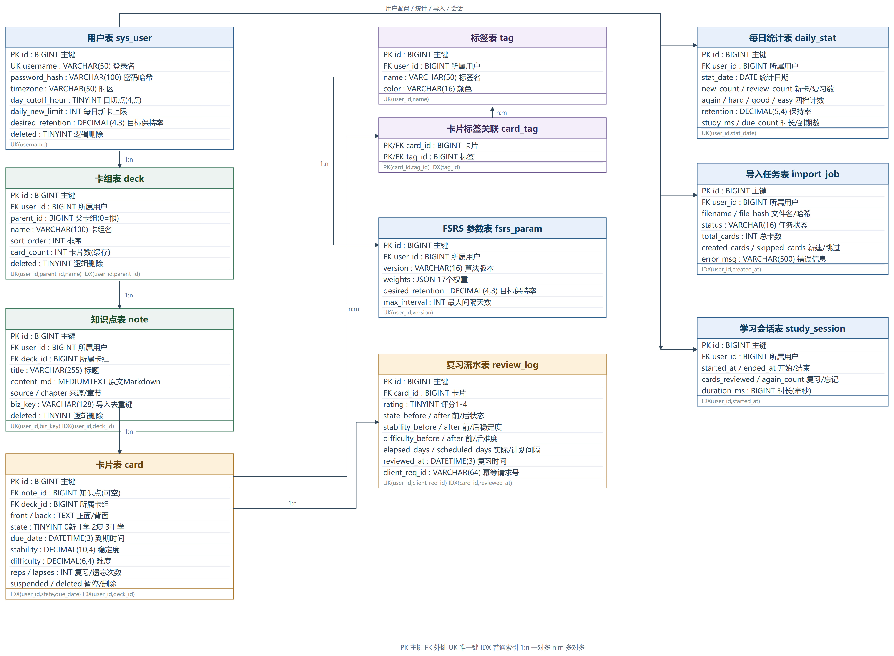
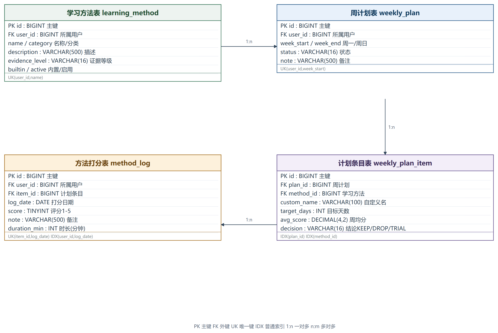
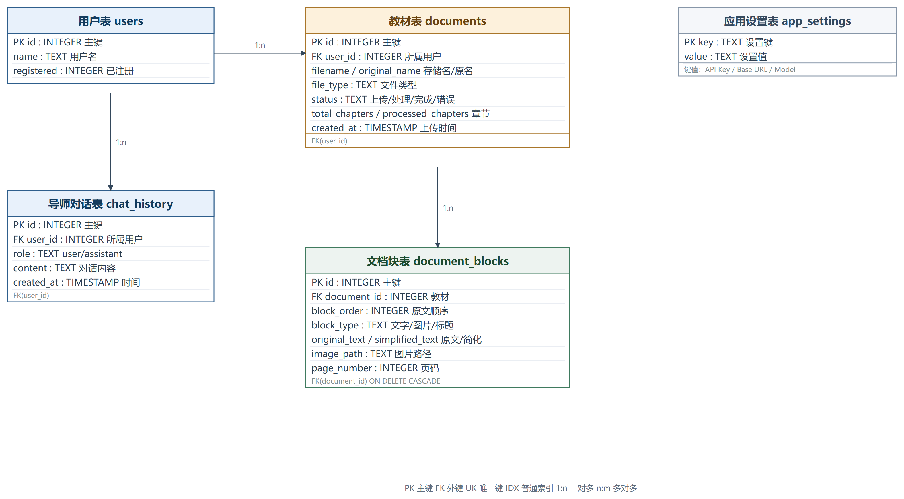

# Memory Lab 数据库存储结构设计

> 对应代码：`backend/src/main/resources/db/migration/V1__init.sql`、`V3__method_lab.sql`、`docs-service/deeptutor/database.py`。  
> 对应 SRS：3.5.2 概念模型图（ER）；本文是更细的**物理表结构**说明。
>
> 注意：**ER 图按项目约定指概念模型图**，只画实体和联系；本文的三张图是物理表结构图，不是 ER 图。

概念模型（ER）单独见：[concept-er.png](figures/concept-er.png)；本文以下三张图都是物理表结构图。

## 1. 总览

Memory Lab 不是单库设计，而是：

```text
业务库（H2 / MySQL）      卡片、卡组、FSRS、复习流水、统计、方法实验
文档库（SQLite）          教材、文档块、教程、导师聊天、设置
文件仓（data/）           原始教材、教程 DOCX/HTML、图片、DeepTutor 数据
```

物理落点：

```text
data/db/memory.mv.db          H2 业务库
data/docs/tutor.db            SQLite 文档库
data/docs/uploads/            原始 PDF/Word/PPT
data/docs/tutorials/doc_<id>/ 图文教程、图片
data/deeptutor/               DeepTutor 独立工作区
```

### 1.1 业务库核心表



### 1.2 方法实验室



### 1.3 文档库



---

## 2. 业务库：用户、内容、复习

### 2.1 sys_user

```text
sys_user(
  id BIGINT PK AUTO_INCREMENT,
  username VARCHAR(50) NOT NULL UNIQUE,
  password_hash VARCHAR(100) NOT NULL DEFAULT '',
  nickname VARCHAR(50),
  email VARCHAR(100),
  timezone VARCHAR(50) NOT NULL DEFAULT 'Asia/Shanghai',
  day_cutoff_hour TINYINT NOT NULL DEFAULT 4,
  daily_new_limit INT NOT NULL DEFAULT 20,
  daily_review_limit INT NOT NULL DEFAULT 200,
  desired_retention DECIMAL(4,3) NOT NULL DEFAULT 0.900,
  created_at DATETIME(3),
  updated_at DATETIME(3),
  deleted TINYINT NOT NULL DEFAULT 0
)
```

| 设计点 | 说明 |
|---|---|
| 单用户 | 便携版固定 `id=1`，但保留 `user_id` 供以后扩展 |
| 日切点 | `day_cutoff_hour=4`，凌晨 4 点前算前一天 |
| 学习上限 | 每日新卡/复习上限，控制队列规模 |
| 目标保持率 | `desired_retention` 控制 FSRS 间隔长度 |

### 2.2 deck

```text
deck(
  id BIGINT PK,
  user_id BIGINT NOT NULL,
  parent_id BIGINT NOT NULL DEFAULT 0,
  name VARCHAR(100) NOT NULL,
  description VARCHAR(500),
  sort_order INT NOT NULL DEFAULT 0,
  card_count INT NOT NULL DEFAULT 0,
  created_at / updated_at DATETIME(3),
  deleted TINYINT NOT NULL DEFAULT 0,
  UNIQUE(user_id, parent_id, name),
  INDEX(user_id, parent_id)
)
```

- `parent_id=0` 表示根卡组；通过 `parent_id` 形成章节树。
- `card_count` 是列表展示用的缓存字段，新增/删除卡时维护。
- 逻辑删除，删除卡组不物理删数据。

### 2.3 note

```text
note(
  id BIGINT PK,
  user_id BIGINT NOT NULL,
  deck_id BIGINT NOT NULL,
  title VARCHAR(255) NOT NULL,
  content_md MEDIUMTEXT,
  source VARCHAR(255),
  chapter VARCHAR(50),
  biz_key VARCHAR(128),
  created_at / updated_at DATETIME(3),
  deleted TINYINT NOT NULL DEFAULT 0,
  UNIQUE(user_id, biz_key),
  INDEX(user_id, deck_id)
)
```

- 一个知识点可以生成多张卡。
- `biz_key` 用于导入去重；手工创建的 note 允许 `biz_key=NULL`。
- `content_md` 保留原始 Markdown 内容，便于重新生成卡。

### 2.4 card

```text
card(
  id BIGINT PK,
  user_id BIGINT NOT NULL,
  note_id BIGINT NULL,
  deck_id BIGINT NOT NULL,
  card_type VARCHAR(16) NOT NULL DEFAULT 'QA',
  front TEXT NOT NULL,
  back TEXT NOT NULL,
  extra MEDIUMTEXT,
  state TINYINT NOT NULL DEFAULT 0,
  due_date DATETIME(3) NOT NULL,
  last_review DATETIME(3),
  stability DECIMAL(10,4) NOT NULL DEFAULT 0,
  difficulty DECIMAL(6,4) NOT NULL DEFAULT 0,
  elapsed_days INT NOT NULL DEFAULT 0,
  scheduled_days INT NOT NULL DEFAULT 0,
  reps INT NOT NULL DEFAULT 0,
  lapses INT NOT NULL DEFAULT 0,
  learning_step TINYINT NOT NULL DEFAULT 0,
  suspended TINYINT NOT NULL DEFAULT 0,
  leech TINYINT NOT NULL DEFAULT 0,
  favorite TINYINT NOT NULL DEFAULT 0,
  wrong TINYINT NOT NULL DEFAULT 0,
  wrong_count INT NOT NULL DEFAULT 0,
  last_wrong_at DATETIME(3),
  version INT NOT NULL DEFAULT 0,
  created_at / updated_at DATETIME(3),
  deleted TINYINT NOT NULL DEFAULT 0,
  INDEX(user_id, state, due_date),
  INDEX(user_id, deck_id),
  INDEX(user_id, favorite),
  INDEX(user_id, wrong),
  INDEX(note_id)
)
```

这是业务库最核心的表，同时保存**内容**和**FSRS 当前快照**：

| 字段组 | 作用 |
|---|---|
| `front/back/extra` | 卡片内容 |
| `state` | 0 NEW、1 LEARNING、2 REVIEW、3 RELEARNING |
| `due_date` | 下次到期时间，复习队列直接按它排序 |
| `stability/difficulty` | FSRS 两个状态量 |
| `reps/lapses` | 成功复习次数、遗忘次数 |
| `learning_step` | 学习/重学步骤 |
| `suspended` | 暂停后不进队列 |
| `leech` | 反复遗忘标记 |
| `favorite` | 收藏；卡片浏览器/复习页可切换 |
| `wrong` | 当前是否在错题集：最近一次评分 ≤2 置 1，评分 ≥3 清 0 |
| `wrong_count` | 历史做错次数，不因答对而清零 |
| `last_wrong_at` | 最近一次做错时间，错题集按它倒序 |
| `version` | 乐观锁，防止并发覆盖 |

`note_id` 允许 NULL，因为卡片可以独立创建；`deck_id` 放在 card 上是有意的反范式，方便直接按卡组查询。

收藏与错题集不另建表：它们是卡片上的两个可检索状态。错题集只保留“当前错题”，历史错误次数留在 `wrong_count`；这样答对后不会继续污染错题列表，但仍能做长期统计。迁移见 `V4__collections.sql`。

### 2.5 tag / card_tag

```text
tag(
  id BIGINT PK,
  user_id BIGINT NOT NULL,
  name VARCHAR(50) NOT NULL,
  color VARCHAR(16),
  created_at DATETIME(3),
  UNIQUE(user_id, name)
)

card_tag(
  card_id BIGINT NOT NULL,
  tag_id BIGINT NOT NULL,
  PRIMARY KEY(card_id, tag_id),
  INDEX(tag_id)
)
```

- 卡片与标签多对多。
- 联合主键保证同一张卡不会重复挂同一个标签。
- `tag` 单独维护名称和颜色，改标签名不用改所有卡。

### 2.6 review_log

```text
review_log(
  id BIGINT PK,
  user_id BIGINT NOT NULL,
  card_id BIGINT NOT NULL,
  rating TINYINT NOT NULL,
  state_before / state_after TINYINT,
  stability_before / stability_after DECIMAL(10,4),
  difficulty_before / difficulty_after DECIMAL(6,4),
  elapsed_days INT,
  scheduled_days INT,
  review_duration_ms INT,
  reviewed_at DATETIME(3),
  client_req_id VARCHAR(64),
  UNIQUE(user_id, client_req_id),
  INDEX(card_id, reviewed_at),
  INDEX(user_id, reviewed_at)
)
```

设计原则：**只追加，不更新**。

- 保存复习前后完整快照，可回放、可审计；
- 统计可以从流水重算；
- `client_req_id` 保证幂等：同一次提交重复发送不会产生两条记录；
- 不物理删除，保留历史。

### 2.7 fsrs_param

```text
fsrs_param(
  id BIGINT PK,
  user_id BIGINT NOT NULL,
  version VARCHAR(16) NOT NULL DEFAULT 'v4.5',
  weights JSON NOT NULL,
  desired_retention DECIMAL(4,3) NOT NULL DEFAULT 0.900,
  max_interval INT NOT NULL DEFAULT 36500,
  created_at / updated_at DATETIME(3),
  UNIQUE(user_id, version)
)
```

- `weights` 是 17 个 FSRS 权重，JSON 保存，避免为每个权重建列；
- `version` 支持以后切换 v5/v6；
- `max_interval` 限制最长间隔，默认 100 年，实际由 UI/策略约束。

### 2.8 daily_stat

```text
daily_stat(
  id BIGINT PK,
  user_id BIGINT NOT NULL,
  stat_date DATE NOT NULL,
  new_count INT,
  review_count INT,
  again_count / hard_count / good_count / easy_count INT,
  retention DECIMAL(5,4),
  study_ms BIGINT,
  due_count INT,
  UNIQUE(user_id, stat_date)
)
```

- 预聚合表，统计页直接读，不必每次扫 `review_log`；
- `review_log` 是事实源，`daily_stat` 是派生数据，可重建；
- `stat_date` 按用户时区和日切点计算。

### 2.9 import_job

```text
import_job(
  id BIGINT PK,
  user_id BIGINT NOT NULL,
  filename VARCHAR(255) NOT NULL,
  file_hash CHAR(64),
  status VARCHAR(16) NOT NULL DEFAULT 'PENDING',
  total_notes / total_cards INT,
  created_cards / skipped_cards INT,
  error_msg VARCHAR(500),
  created_at DATETIME(3),
  finished_at DATETIME(3),
  INDEX(user_id, created_at)
)
```

- 记录一次 DOCX 导入任务；
- `file_hash` 识别重复文件；
- `created_cards/skipped_cards` 让用户知道去重结果；
- `status` 取 `PENDING/PROCESSING/DONE/FAILED`。

### 2.10 study_session

```text
study_session(
  id BIGINT PK,
  user_id BIGINT NOT NULL,
  started_at DATETIME(3) NOT NULL,
  ended_at DATETIME(3),
  cards_reviewed INT,
  again_count INT,
  duration_ms BIGINT,
  INDEX(user_id, started_at)
)
```

记录一次学习会话的时长和复习量，用于“学习时长/连续天数”等统计。

---

## 3. 方法实验室

### 3.1 learning_method

```text
learning_method(
  id BIGINT PK,
  user_id BIGINT NOT NULL DEFAULT 1,
  name VARCHAR(100) NOT NULL,
  category VARCHAR(32),
  description VARCHAR(500),
  evidence_level VARCHAR(16) NOT NULL DEFAULT 'MEDIUM',
  source VARCHAR(255),
  builtin TINYINT NOT NULL DEFAULT 0,
  active TINYINT NOT NULL DEFAULT 1,
  created_at DATETIME(3),
  UNIQUE(user_id, name)
)
```

- `category`：retrieval / spacing / interleaving / elaboration / note-taking / other；
- `evidence_level`：HIGH / MEDIUM / LOW；
- `builtin` 区分内置方法和用户自定义方法。

### 3.2 weekly_plan

```text
weekly_plan(
  id BIGINT PK,
  user_id BIGINT NOT NULL DEFAULT 1,
  week_start DATE NOT NULL,
  week_end DATE NOT NULL,
  status VARCHAR(16) NOT NULL DEFAULT 'DRAFT',
  note VARCHAR(500),
  created_at / updated_at DATETIME(3),
  UNIQUE(user_id, week_start)
)
```

`status`：`DRAFT/ACTIVE/REVIEWED`；每周一个计划。

### 3.3 weekly_plan_item

```text
weekly_plan_item(
  id BIGINT PK,
  plan_id BIGINT NOT NULL,
  method_id BIGINT NULL,
  custom_name VARCHAR(100),
  target_days INT NOT NULL DEFAULT 5,
  avg_score DECIMAL(4,2),
  decision VARCHAR(16),
  created_at DATETIME(3),
  INDEX(plan_id),
  INDEX(method_id)
)
```

- 一个周计划包含 3～5 个方法条目；
- `method_id` 为空时使用 `custom_name` 表示自定义方法；
- `decision`：`KEEP/DROP/TRIAL`。

### 3.4 method_log

```text
method_log(
  id BIGINT PK,
  user_id BIGINT NOT NULL DEFAULT 1,
  item_id BIGINT NOT NULL,
  log_date DATE NOT NULL,
  score TINYINT NOT NULL,
  note VARCHAR(500),
  duration_min INT NOT NULL DEFAULT 0,
  created_at / updated_at DATETIME(3),
  UNIQUE(item_id, log_date),
  INDEX(user_id, log_date)
)
```

- 同一计划条目同一天只能打一次分；
- 周均分由该表聚合；
- `score` 范围 1～5。

---

## 4. 文档库

文档服务使用 SQLite：`data/docs/tutor.db`。开启：

```sql
PRAGMA journal_mode=WAL;
PRAGMA foreign_keys=ON;
```

### 4.1 documents

```text
documents(
  id INTEGER PK AUTOINCREMENT,
  user_id INTEGER NOT NULL,
  filename TEXT NOT NULL,
  original_name TEXT NOT NULL,
  file_type TEXT NOT NULL,
  status TEXT DEFAULT 'uploaded',
  total_chapters INTEGER DEFAULT 0,
  processed_chapters INTEGER DEFAULT 0,
  created_at TIMESTAMP,
  FOREIGN KEY(user_id) REFERENCES users(id)
)
```

`status`：`uploaded / processing / processed / error`。

### 4.2 document_blocks

```text
document_blocks(
  id INTEGER PK AUTOINCREMENT,
  document_id INTEGER NOT NULL,
  chapter_title TEXT,
  block_order INTEGER NOT NULL,
  block_type TEXT NOT NULL,
  original_text TEXT,
  simplified_text TEXT,
  image_path TEXT,
  image_description TEXT,
  page_number INTEGER,
  FOREIGN KEY(document_id) REFERENCES documents(id) ON DELETE CASCADE
)
```

这是文档链路的核心：

| 字段 | 作用 |
|---|---|
| `block_order` | 保持原文图文顺序 |
| `block_type` | text / heading / image / slide_title |
| `original_text` | 原始文字 |
| `simplified_text` | LLM 简化结果 |
| `image_path` | 图片文件路径，不存二进制 |
| `page_number` | 来源页码，方便定位 |

### 4.3 chat_history / app_settings

```text
chat_history(
  id INTEGER PK,
  user_id INTEGER NOT NULL,
  role TEXT NOT NULL,
  content TEXT NOT NULL,
  created_at TIMESTAMP,
  FOREIGN KEY(user_id) REFERENCES users(id)
)

app_settings(
  key TEXT PRIMARY KEY,
  value TEXT DEFAULT ''
)
```

- `chat_history` 保存导师上下文；
- `app_settings` 是键值表，保存 API Key / Base URL / Model 等本机设置。

### 4.4 文档库其余表

| 表 | 用途 |
|---|---|
| `users` | 文档服务本地用户，固定 id=1 |
| `character_stats` | 导师/学习 RPG 属性 |
| `skills` | 课程/书籍技能进度 |
| `study_sessions` | 学习会话 |
| `learning_preferences` | 学习偏好 |
| `review_schedule` | 文档服务的艾宾浩斯复习计划 |
| `daily_plan` | 每日任务 |
| `pomodoro_sessions` | 番茄钟 |

> `review_schedule` 不是业务库的 FSRS；FSRS 的当前状态和流水在 `card` / `review_log`。

---

## 5. 关系总表

```text
sys_user 1 ── n deck
deck     1 ── n note
note     1 ── n card
card     n ── m tag            via card_tag
card     1 ── n review_log
sys_user 1 ── n fsrs_param
sys_user 1 ── n daily_stat
sys_user 1 ── n import_job
sys_user 1 ── n study_session
sys_user 1 ── n learning_method
learning_method 1 ── n weekly_plan_item
weekly_plan     1 ── n weekly_plan_item
weekly_plan_item 1 ── n method_log

documents 1 ── n document_blocks
users     1 ── n documents
users     1 ── n chat_history
```

跨库不建外键，由应用层衔接：

```text
document_blocks
   │ 生成结构化 DOCX
   ▼
POST /api/v1/import/docx
   │
   ▼
note / card
```

---

## 6. 索引清单

| 表 | 索引 | 用途 |
|---|---|---|
| `deck` | `(user_id,parent_id)` | 卡组树 |
| `note` | `(user_id,deck_id)` | 卡组下的笔记 |
| `note` | `(user_id,biz_key)` UNIQUE | 导入去重 |
| `card` | `(user_id,state,due_date)` | 到期队列 |
| `card` | `(user_id,deck_id)` | 卡组筛选 |
| `card` | `(note_id)` | 知识点下的卡 |
| `review_log` | `(card_id,reviewed_at)` | 单卡历史 |
| `review_log` | `(user_id,reviewed_at)` | 用户历史 |
| `review_log` | `(user_id,client_req_id)` UNIQUE | 幂等 |
| `daily_stat` | `(user_id,stat_date)` UNIQUE | 每日统计 |
| `import_job` | `(user_id,created_at)` | 导入历史 |
| `study_session` | `(user_id,started_at)` | 会话历史 |
| `method_log` | `(item_id,log_date)` UNIQUE | 每日打分 |
| `method_log` | `(user_id,log_date)` | 方法统计 |
| `document_blocks` | 无显式索引 | 数据量小，按 `document_id` 查 |

---

## 7. 关键设计取舍

### 7.1 为什么 card 同时有 note_id 和 deck_id

- `note_id` 追溯知识点；
- `deck_id` 直接支持按卡组查询/统计，避免每次 join note；
- 轻微冗余换查询简单。

### 7.2 为什么 review_log 存 before/after 快照

- 可以回放一次复习前后的状态；
- 统计不依赖当前 card 状态；
- 出问题时能看出是哪一步异常；
- 流水不可变，避免“改历史”。

### 7.3 为什么 daily_stat 可以重算

`daily_stat` 是派生表，事实源是 `review_log`。  
如果统计表损坏或口径变化，按日期重跑聚合即可。

### 7.4 为什么业务库没有物理外键

- H2 便携版与 MySQL 开发版保持一致；
- 单用户写入路径简单，应用层控制更灵活；
- 导入/删除时可以自己决定顺序，避免外键级联锁。

代价是应用层要保证引用完整性，建议定期做孤儿检查：

```sql
SELECT c.id
FROM card c LEFT JOIN note n ON c.note_id=n.id
WHERE c.note_id IS NOT NULL AND n.id IS NULL;

SELECT d.id, d.card_count, COUNT(c.id)
FROM deck d LEFT JOIN card c ON c.deck_id=d.id AND c.deleted=0
WHERE d.deleted=0
GROUP BY d.id
HAVING d.card_count <> COUNT(c.id);
```

文档库 SQLite 则使用 `FOREIGN KEY ... ON DELETE CASCADE`，删除文档自动删块。

### 7.5 为什么大文件不进数据库

- `documents` 只存元数据；
- `document_blocks` 只存 `image_path`；
- 原文件在 `uploads/`，教程在 `tutorials/`；
- 数据库小、备份快，图片不会拖慢文本查询。

---

## 8. 迁移与备份

Flyway：

```text
V1__init.sql        业务库 11 张表
V2__seed.sql        默认用户、FSRS 参数、默认卡组
V3__method_lab.sql  方法实验室 4 张表
```

备份整个 `data/`：

```text
data/db/            H2 业务库
data/docs/tutor.db  SQLite 文档库
data/docs/uploads/  原始教材
data/docs/tutorials/教程
```

恢复时停服务 → 还原 `data/` → 启动。数据库和上传文件必须一起恢复，否则会出现“有记录、没图片”。

---

## 9. 与 SRS 的关系

- SRS 3.5.2 的 ER 图是**概念模型图**，只画实体和联系；
- 本文是完整 15 张业务表 + 文档库的**物理表结构**，不是 ER 图；
- 如果要把本文并入 SRS，可作为 **3.5.2.1 存储结构详细设计** 或 **附录 C 数据库表结构**。
